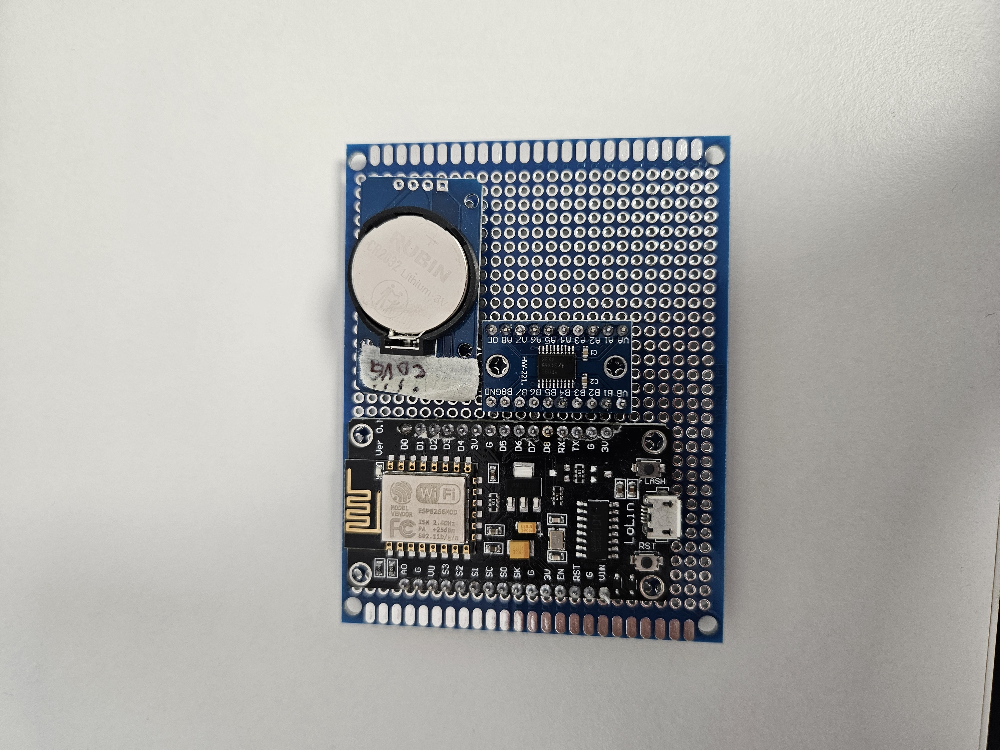
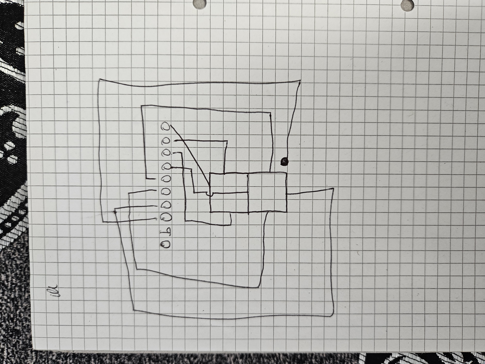
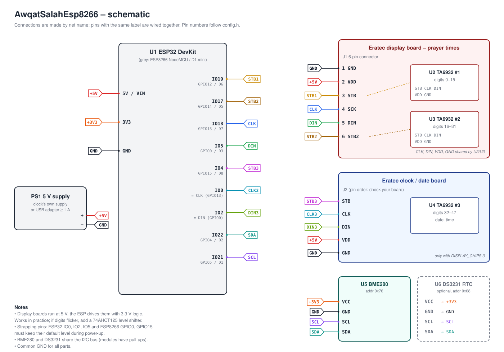
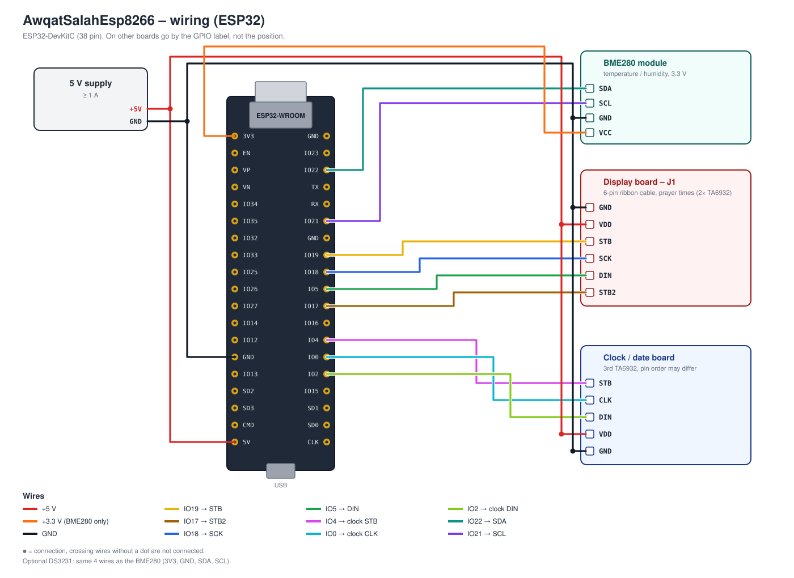

<a name="readme-top"></a>

<div align="center">
  

  <h3 align="center">AwqatSalahEsp8266</h3>

  <p align="center">
    Retrofit an Eratec prayer time clock with an ESP32 or ESP8266 and the official Diyanet Awqat Salah API.
  </p>
</div>

<details>
  <summary>Table of Contents</summary>
  <ol>
    <li><a href="#about-the-project">About the project</a></li>
    <li><a href="#features">Features</a></li>
    <li><a href="#hardware">Hardware</a></li>
    <li><a href="#getting-started">Getting started</a></li>
    <li><a href="#configuration">Configuration</a></li>
    <li><a href="#how-it-works">How it works</a></li>
    <li><a href="#troubleshooting">Troubleshooting</a></li>
    <li><a href="#roadmap">Roadmap</a></li>
    <li><a href="#acknowledgments">Acknowledgments</a></li>
  </ol>
</details>


## About the project

Eratec prayer time clocks are common in mosques and homes. Their prayer times
normally come from a fixed table that has to be updated by hand. This project
replaces the clock's controller with an ESP32 or ESP8266 that downloads the
prayer times every day from the official
[Awqat Salah API](https://awqatsalah.diyanet.gov.tr) of the Turkish Presidency
of Religious Affairs (Diyanet) and shows them on the original 7-segment display.

<p align="center">
  
  
  
</p>

<p align="right">(<a href="#readme-top">back to top</a>)</p>


## Features

- Runs on **ESP32** and **ESP8266**, the board is detected automatically
- Downloads the six daily times (fajr/imsak, sunrise, dhuhr, asr, maghrib, isha) for a whole month
  and stores them in flash: the clock keeps working for weeks without internet and survives restarts
- Current time and date on the clock board (third TA6932 chip)
- Time from NTP with automatic daylight saving time (POSIX time zone string)
- Temperature from a BME280 or the DS3231
- Top-left field: countdown to the next prayer time, or humidity from the BME280
- Optional DS3231 RTC keeps the time when Wi-Fi or NTP are unavailable
- Few API requests: a new download only when fewer than 5 days are left, failed attempts are retried with growing pauses
- Shows `--:--` until today's times are known
- No modified libraries needed: the TA6932 driver is part of the sketch (`src/TA6932Chain`)
- Setup in the browser: Wi-Fi, API account, city and time zone, no recompiling
  (setup access point with captive portal on first start, later `http://awqatsalah.local`)
- Firmware updates over Wi-Fi (Arduino OTA), progress shown on the display

<p align="right">(<a href="#readme-top">back to top</a>)</p>


## Hardware

| Part | Notes |
|---|---|
| Eratec prayer time clock | display boards with two (prayer times) or three (plus clock/date) TA6932 LED driver chips |
| ESP32 or ESP8266 board | e.g. ESP32 DevKit, NodeMCU, Wemos D1 mini |
| BME280 module (optional) | temperature and humidity, I2C |
| DS3231 RTC module (optional) | backup clock with battery, I2C |
| 5 V supply | the clock's own supply can usually be reused, the board regulates to 3.3 V |

### Schematic



### Wiring diagram (ESP32)



The display board's 6-pin ribbon connector (J1) carries `GND, VDD, STB, SCK, DIN, STB2`
in this order. The pin order of the clock/date board connector is not documented yet,
check the labels on your board. Both diagrams are generated by
[`docs/make_diagrams.py`](docs/make_diagrams.py) (`python docs/make_diagrams.py`),
update it together with `config.h` when you change pins.

### Wiring (defaults in `config.h`)

| Signal | ESP32 GPIO | ESP8266 GPIO (pin) |
|---|---|---|
| TA6932 chip 1 STB | 19 | 12 (D6) |
| TA6932 chip 2 STB | 17 | 14 (D5) |
| TA6932 chip 1+2 CLK | 18 | 13 (D7) |
| TA6932 chip 1+2 DIN | 5 | 0 (D3) |
| TA6932 chip 3 STB | 4 | 15 (D8) |
| TA6932 chip 3 CLK | 0 | shared with chip 1+2 |
| TA6932 chip 3 DIN | 2 | shared with chip 1+2 |
| I2C SDA (BME280 / DS3231) | 22 | 4 (D2) |
| I2C SCL (BME280 / DS3231) | 21 | 5 (D1) |
| GND | GND | GND, common with the clock |

Default feature set per board (change in `config.h`):

| | ESP32 | ESP8266 |
|---|---|---|
| Display chips | 3 (with clock/date) | 2 |
| Temperature | BME280 | DS3231 |
| RTC | none | DS3231 |

**Strapping pins:** ESP32 GPIO0, GPIO2 and GPIO5 as well as ESP8266 GPIO0 and
GPIO15 decide the boot mode. They must stay at their default level while the
board powers up. If the board does not boot with the display connected, move
the line to another pin.

### Display layout

The firmware treats all chips as one buffer, 16 digits per chip:

| Positions | Chip | Content |
|---|---|---|
| 0-1 | 1 | countdown to the next prayer (min) or humidity (%) |
| 3-4 | 1 | temperature (°C) |
| 6-9 | 1 | fajr / imsak |
| 10-13 | 1 | sunrise / shuruk |
| 14-17 | 1+2 | dhuhr |
| 18-21 | 2 | asr |
| 22-25 | 2 | maghrib |
| 26-29 | 2 | isha |
| 32-35 | 3 | year |
| 36-37 | 3 | month |
| 38-39 | 3 | day |
| 40-43 | 3 | current time HH:MM |
| 46 | 3 | indicator (`CLOCK_INDICATOR_SEGMENTS`) |

The colon of each prayer row is the dot segment of its 2nd and 3rd digit. If
your clock is wired differently, change the `POS_*` constants at the top of the
sketch.

<p align="right">(<a href="#readme-top">back to top</a>)</p>


## Getting started

### Prerequisites

- [Arduino IDE](https://www.arduino.cc/en/software) 2.x (or arduino-cli)
- Board package, under *File → Preferences → Additional boards manager URLs*:
  - ESP32 (2.x, tested with 2.0.11): `https://espressif.github.io/arduino-esp32/package_esp32_index.json`
  - ESP8266 (**3.0 or newer**): `https://arduino.esp8266.com/stable/package_esp8266com_index.json`
- Libraries (library manager):
  - [ArduinoJson](https://arduinojson.org) 6.x or 7.x
  - [Adafruit BME280 Library](https://github.com/adafruit/Adafruit_BME280_Library), if `USE_BME280 1`
  - [RTClib](https://github.com/adafruit/RTClib) by Adafruit, if `USE_RTC_DS3231 1`
- An Awqat Salah API account (see below)

### Awqat Salah API access

The API is free but requires an account. Request access on
[awqatsalah.diyanet.gov.tr](https://awqatsalah.diyanet.gov.tr) (user request
form); you receive an e-mail address/password pair for the API.

The API limits the requests per endpoint and city (currently 10, 100 during the
first 15 days of a new account; check your quota with `GET /api/Quota/My`).
The clock therefore downloads a month at once (`/api/PrayerTime/Monthly/{cityId}`)
and normally needs only about one request per month.

### Finding your city id

Log in once and look up your city through the place endpoints (country → state → city):

```sh
# 1. get a token
curl -s -X POST https://awqatsalah.diyanet.gov.tr/Auth/Login \
     -H "Content-Type: application/json" \
     -d '{"email":"YOUR_LOGIN_EMAIL","password":"YOUR_AWQAT_PASSWORD"}'
# -> copy data.accessToken

TOKEN=...

# 2. countries, then states of a country, then cities of a state
curl -s -H "Authorization: Bearer $TOKEN" https://awqatsalah.diyanet.gov.tr/api/Place/Countries
curl -s -H "Authorization: Bearer $TOKEN" https://awqatsalah.diyanet.gov.tr/api/Place/States/<countryId>
curl -s -H "Authorization: Bearer $TOKEN" https://awqatsalah.diyanet.gov.tr/api/Place/Cities/<stateId>

# 3. check the result
curl -s -H "Authorization: Bearer $TOKEN" https://awqatsalah.diyanet.gov.tr/api/PrayerTime/Daily/<cityId>
```

Enter the `id` of your city in the web interface. A daily response looks like this
(shortened):

```json
{"data":[{"fajr":"04:40","sunrise":"06:27","dhuhr":"12:26","asr":"15:29",
          "maghrib":"18:16","isha":"19:49","gregorianDateShort":"12.03.2023", ...}],
 "success":true,"message":null}
```

### Build and flash

1. Clone the repository. The folder name must stay `AwqatSalahEsp8266`, matching
   the sketch file, so the Arduino IDE can open it.
   ```sh
   git clone https://github.com/esrfkos/AwqatSalahEsp8266.git
   ```
2. Check the hardware block of your board in `config.h`.
3. Open `AwqatSalahEsp8266.ino`, select your board (e.g. *ESP32 Dev Module*, *NodeMCU 1.0*,
   *LOLIN(WEMOS) D1 mini*) and the USB port, then upload. On the ESP8266 choose a flash size
   with file system and OTA, e.g. *4MB (FS:2MB OTA:~1019KB)*.
4. Open the serial monitor at 115200 baud to watch the start-up.

`secrets.h` is optional: credentials entered there are only defaults for the first start
(copy `secrets.example.h`).

### First setup

1. After the first upload the display shows **`AP`** in the top-left field.
2. Connect a phone or laptop to the Wi-Fi **`AwqatSalah-XXXX`**, password `awqatsalah`
   (`DEFAULT_DEVICE_PASSWORD`). The settings page opens automatically; if not, open
   `http://192.168.4.1`.
3. Enter your Wi-Fi, the Awqat Salah API account, the city id and a new **device password**,
   then *Save and restart*.
4. The clock connects to your Wi-Fi, downloads the prayer times and shows them.

If the configured Wi-Fi is not reachable at start-up (e.g. after a router change), the setup
access point opens again for 5 minutes, then the clock restarts and tries the Wi-Fi again.

### Web interface

In the home network open **`http://awqatsalah.local`** (or the IP address from the serial
monitor). Log in as user `admin` with the device password. The page shows the status
(time, today's prayer times, stored days, Wi-Fi signal, free memory) and the settings.
*Download prayer times now* starts a download immediately (counts against the API limit).
Password fields stay empty; leave them empty to keep the stored passwords.

### Firmware updates over Wi-Fi (OTA)

1. Computer and clock must be in the same network.
2. In the Arduino IDE choose *Tools → Port → awqatsalah at 192.168.x.x* (network port).
3. Upload as usual; the IDE asks for the device password.
4. The top-left field shows the progress in percent, then the clock restarts.

Settings and stored prayer times are kept during updates.

<p align="right">(<a href="#readme-top">back to top</a>)</p>


## Configuration

Wi-Fi, API account, city id, time zone and device password are set in the
[web interface](#web-interface) and stored in LittleFS (`/settings.json`).
The values in `config.h` / `secrets.h` are only the defaults for the first start.

Compile-time settings in [`config.h`](config.h):

| Setting | Default | Meaning |
|---|---|---|
| `AWQAT_CITY_ID` | `""` | default city id |
| `TIME_ZONE` | Central Europe | default POSIX TZ string incl. DST rules |
| `DEVICE_NAME` | `"awqatsalah"` | host name: `http://awqatsalah.local`, OTA port |
| `SETUP_AP_PREFIX` | `"AwqatSalah-"` | name of the setup access point |
| `DEFAULT_DEVICE_PASSWORD` | `"awqatsalah"` | device password until one is set in the web interface |
| `SETUP_PORTAL_TIMEOUT_MS` | 5 min | setup access point timeout when a Wi-Fi is configured |
| `NTP_SERVER_1/2` | pool.ntp.org | time servers |
| `AWQAT_RANGE` | `"Monthly"` | days per download: `"Monthly"`, `"Weekly"` or `"Daily"` |
| `REFRESH_DAYS_AHEAD` | 5 | download again when fewer days (incl. today) are stored |
| `FETCH_HOUR`, `FETCH_MINUTE` | 03:05 | time of the daily refresh attempt |
| `FETCH_RETRY_MIN_MS`, `FETCH_RETRY_MAX_MS` | 5 min, 6 h | pause after a failed download while today is missing, doubles each time |
| `WIFI_TIMEOUT_MS`, `NTP_TIMEOUT_MS` | 20 s, 10 s | how long start-up waits before continuing |
| `DISPLAY_BRIGHTNESS` | 7 | 0 (dim) to 7 (bright) |
| `TOP_LEFT_FIELD` | `FIELD_COUNTDOWN` | `FIELD_OFF`, `FIELD_COUNTDOWN` or `FIELD_HUMIDITY` |
| `DISPLAY_CHIPS` | ESP32: 3, ESP8266: 2 | 3 = with clock/date board |
| `USE_BME280`, `BME280_I2C_ADDRESS` | ESP32: 1, 0x76 | BME280 sensor |
| `USE_RTC_DS3231` | ESP8266: 1 | DS3231 backup clock |
| `TEMPERATURE_SOURCE` | per board | `TEMP_NONE`, `TEMP_BME280` or `TEMP_DS3231` |
| `CLOCK_INDICATOR_SEGMENTS` | `0b01011011` | segments of the indicator on chip 3, 0 = off |
| `PIN_*` | see wiring | GPIO assignment |

Contradicting settings (e.g. humidity without BME280) stop the build with a clear error.

Optional defaults in `secrets.h` (ignored by git):
`WIFI_SSID`, `WIFI_PASSWORD`, `AWQAT_EMAIL`, `AWQAT_PASSWORD`, `DEVICE_PASSWORD`.

<p align="right">(<a href="#readme-top">back to top</a>)</p>


## How it works

```
setup()
 ├─ init display, show "--:--"
 ├─ mount LittleFS, load settings (/settings.json) and stored days (/prayer_times.bin)
 ├─ init I2C sensors (BME280 / DS3231), continue without them if missing
 ├─ connect Wi-Fi (max. 20 s)
 │    ok   → web interface + OTA, http://awqatsalah.local
 │    fail → setup access point with captive portal, "AP" on the display
 └─ start NTP; if no sync within 10 s, set the system time from the DS3231

loop()
 ├─ web interface / captive portal, OTA
 ├─ after each NTP sync: write the time to the DS3231
 ├─ today not stored?                → download now, on failure retry after 5, 10, 20 … min (max. 6 h)
 ├─ fewer than 5 days left, ≥ 03:05?  → one download attempt per day
 │    download: POST /Auth/Login → token → GET /api/PrayerTime/Monthly/{cityId}
 │              → merge with the stored days, drop past days, save to flash
 └─ new minute? → redraw prayer rows, countdown/humidity, temperature, clock and date
                  (only chips whose content changed are sent)
```

- The system clock runs in UTC; the RTC stores local time.
- The monthly response is parsed one day at a time with an ArduinoJson filter,
  so it never has to fit into RAM as a whole. Days are matched by their date
  (`gregorianDateShort`, e.g. `12.03.2023`), so it does not matter whether the
  API returns the calendar month or the next 30 days.
- The stored days are bound to the city id; after changing the city the old
  file is ignored and a new download starts.
- Without internet the clock still needs the current time: on boards without
  DS3231 the stored times are only shown once NTP has worked after a restart.
- The HTTPS connection uses `setInsecure()`, i.e. the server certificate is
  **not verified**. This keeps the firmware independent of certificate
  renewals, but a network attacker could read the API credentials. Use a
  dedicated API account and a trusted network.
- The web interface uses plain HTTP with basic auth, the device password is
  readable for anyone in the same network. Change the default device password
  and only use the clock in a network you trust.

<p align="right">(<a href="#readme-top">back to top</a>)</p>


## Troubleshooting

| Serial output / symptom | Cause |
|---|---|
| Display shows `AP` | no Wi-Fi configured or not reachable: connect to `AwqatSalah-XXXX` and enter the Wi-Fi |
| `awqatsalah.local` does not open | some Android devices do not support mDNS, use the IP address from the serial monitor or the router |
| No network port in the Arduino IDE | computer and clock in different networks, or mDNS blocked by the firewall |
| `Fetch skipped: API account or city id missing` | enter them in the web interface |
| Forgot the device password | upload once via USB with the whole flash erased (ESP8266: *Tools → Erase Flash → All Flash Contents*, ESP32: *Tools → Erase All Flash Before Sketch Upload → Enabled*), then set up again |
| `Unsupported board` (compile error) | select an ESP32 or ESP8266 board |
| `TEMPERATURE_SOURCE is ... but ...` (compile error) | enable the sensor or choose another source in `config.h` |
| `Login failed: HTTP 401` | wrong Awqat Salah credentials |
| `Login failed: HTTP 429` or `403` | daily request limit reached, wait until the next day |
| `Prayer times failed: HTTP 404` | wrong city id |
| `HTTP -1 connection refused` | no internet or not enough free heap for TLS |
| `BME280 not found` | check wiring and `BME280_I2C_ADDRESS` (0x76 or 0x77); sensor id 0x56-0x58 is a BMP280 without humidity |
| `DS3231 not found` | check SDA/SCL wiring and the RTC supply |
| Display stays `--:--` | today is not stored and no download worked yet, or the time is unknown; check the serial output |
| `LittleFS not available` | ESP8266: choose a flash size with file system (e.g. *4MB (FS:2MB …)*) in the Tools menu |
| `response contains no valid days` | the API answer changed; please open an issue with the serial output |
| Clock/date board stays dark | `DISPLAY_CHIPS` is 2 or the chip 3 pins are wrong |
| Board does not boot with the display connected | strapping pin pulled at power-up, see wiring |
| Times are one hour off | wrong time zone in the web interface |

<p align="right">(<a href="#readme-top">back to top</a>)</p>


## Roadmap

- [x] Download the daily prayer times from the Awqat Salah API
- [x] NTP time with daylight saving time, DS3231 as backup
- [x] Temperature, humidity and countdown display
- [x] Current time and date on the clock board
- [x] ESP32 support
- [x] Offline operation: monthly download stored in flash
- [x] Setup in the browser (captive portal) and web interface
- [x] Firmware updates over Wi-Fi (OTA)
- [ ] Highlight the current prayer time
- [ ] Adhan / buzzer output at prayer time

<p align="right">(<a href="#readme-top">back to top</a>)</p>


## Acknowledgments

- [Diyanet Awqat Salah API](https://awqatsalah.diyanet.gov.tr)
- [TA6932 library](https://github.com/allenchak/TA6932) by Allen Chak (MIT), basis of the display driver
- [Arduino core for ESP32](https://github.com/espressif/arduino-esp32) and [ESP8266](https://github.com/esp8266/Arduino)
- [ArduinoJson](https://arduinojson.org)
- [Adafruit BME280 Library](https://github.com/adafruit/Adafruit_BME280_Library), [Adafruit RTClib](https://github.com/adafruit/RTClib)
- [Best-README-Template](https://github.com/othneildrew/Best-README-Template)

<p align="right">(<a href="#readme-top">back to top</a>)</p>
